<div align="center">

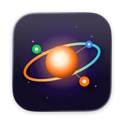

# Agent OS

### A Jarvis-style second brain for every AI tool on your Mac

**See everything your AIs know, did and cost — Claude Code, Codex, Gemini, Copilot, OpenCode, Qwen and more — in one living 3D command center. Native, private, and fast.**

[](#install)
[](Package.swift)
[](Sources/AgentOS/UI/BrainView.swift)
[](#privacy)
[](LICENSE)

[**Download**](../../releases/latest) · [Features](#features) · [Brain styles](#nine-ways-to-see-your-brain) · [How it works](#how-it-works) · [Build from source](#build-from-source)

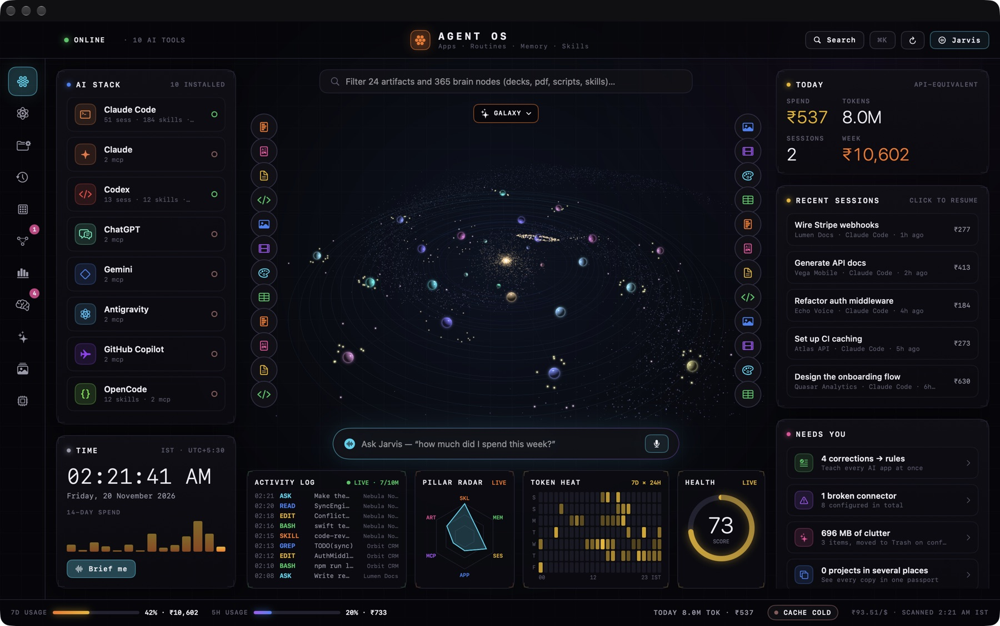

</div>

---

## Why Agent OS?

If you use more than one AI coding tool, your work is scattered across `~/.claude`, `~/.codex`, `~/.gemini`, Copilot, OpenCode, Qwen… Sessions, skills, MCP servers, rules files, memory and costs all live in different folders with different formats.

**Agent OS reads all of them (read-only), joins them into one graph, and turns it into a command center you actually want to keep open** — with a voice assistant that answers from that data, offline.

- 🪐 **Every session, skill, project and file is a clickable planet** in a live 3D brain
- 💸 **Know what you spend** — tokens and API-equivalent cost per project, model, skill and day
- 🧠 **Teach every AI at once** — your corrections become rules in `CLAUDE.md`, `AGENTS.md`, `GEMINI.md`…
- 🎙️ **Jarvis** — ask by voice or text; instant local answers, offline models, or Claude
- 🔒 **Nothing leaves your Mac** — no account, no server, no telemetry

---

## Features

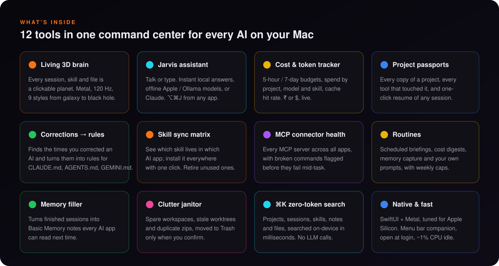

| | |
|---|---|
| 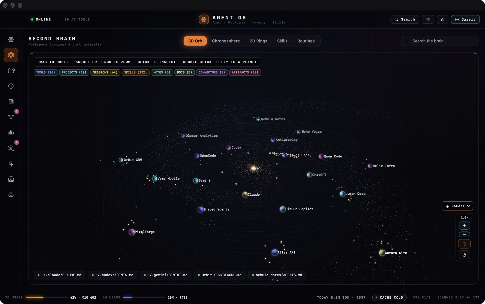 **Second Brain** — tools and projects are planets on Kepler orbits; skills and sessions are moons in Saturn-like rings. Drag, zoom from galaxy to moon, double-click to fly and follow. | 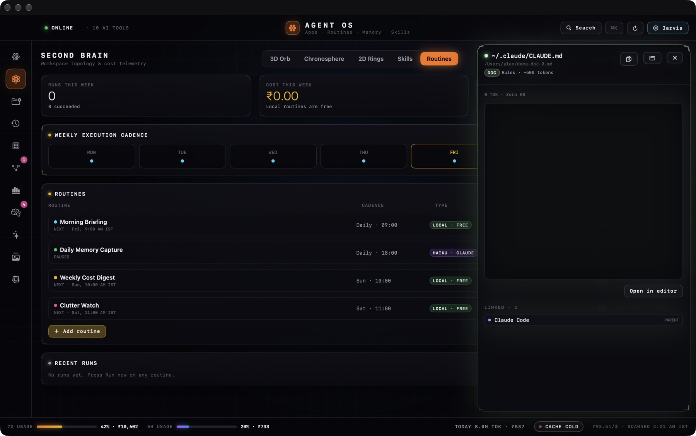 **Inspector** — click any node to read, edit and save the real file (`CLAUDE.md`, `SKILL.md`, notes), resume a session, or walk to linked nodes. |
| 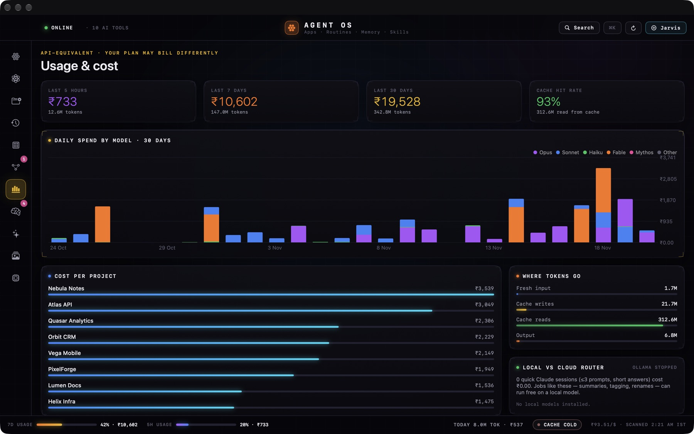 **Usage & cost** — 5-hour / 7-day budgets, daily spend by model, cost per project, cache hit rate, where tokens go. | 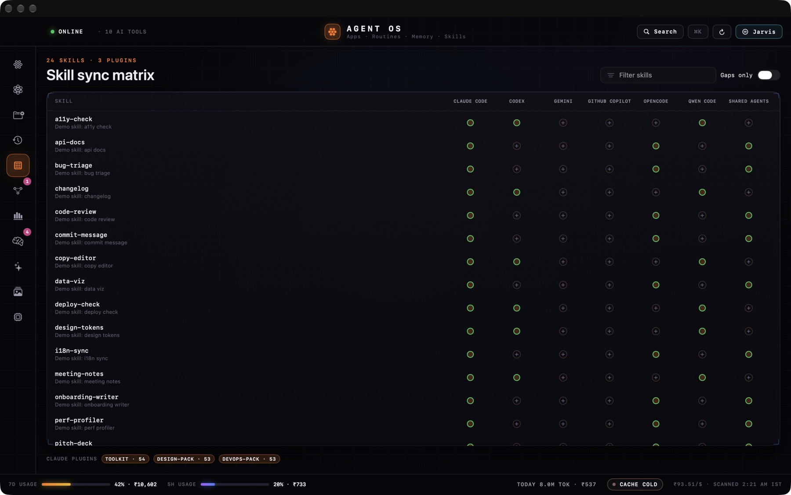 **Skill sync matrix** — every skill × every AI app. One click installs a skill everywhere; retire the ones you never use. |
| 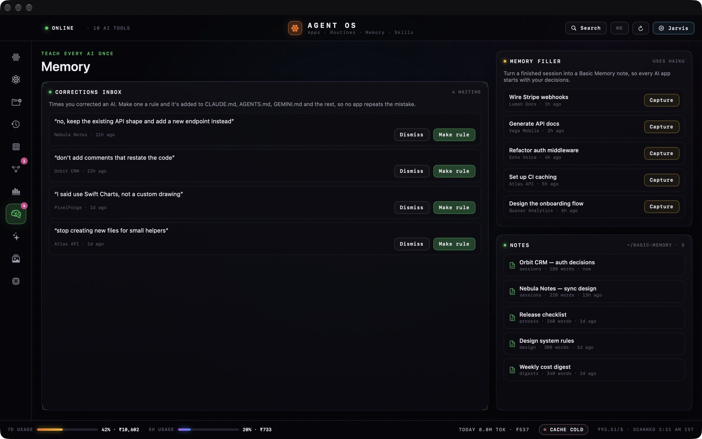 **Memory** — a corrections inbox that turns "no, I said…" into rules, plus a memory filler that turns sessions into notes. | 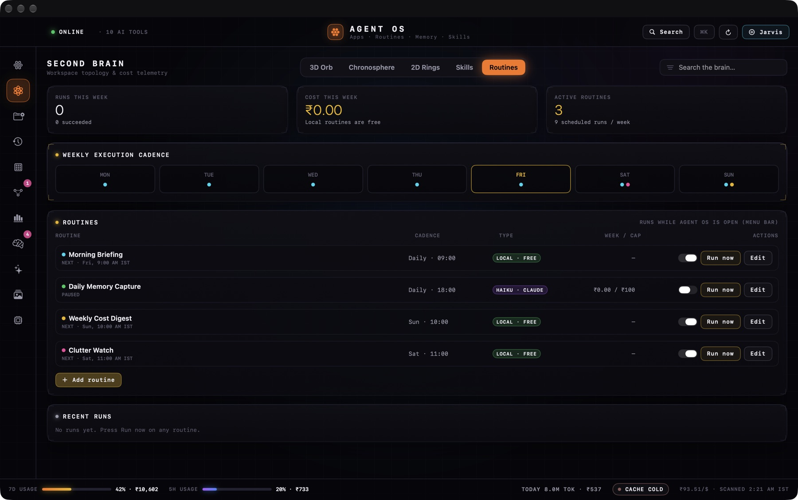 **Routines** — scheduled briefings, cost digests, memory capture and your own prompts, each with a weekly spending cap. |
| 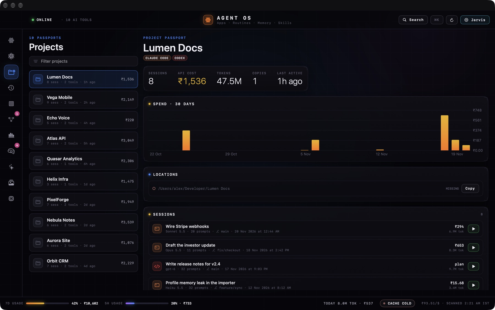 **Project passports** — every copy of a project, every tool that touched it, spend over time, one-click resume. | 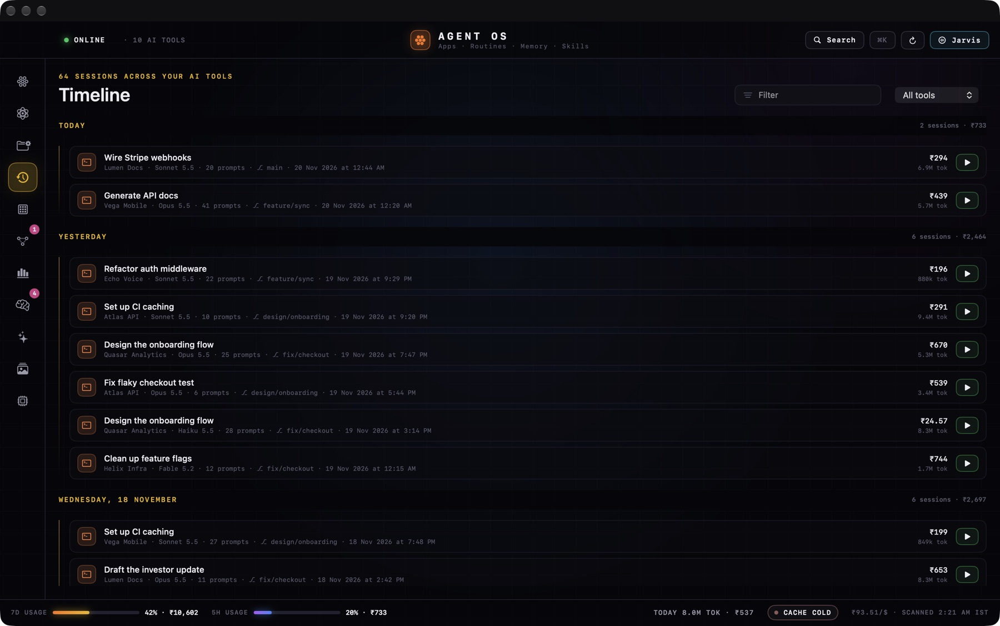 **Timeline** — every AI session across every tool, grouped by day, filterable, resumable. |
| 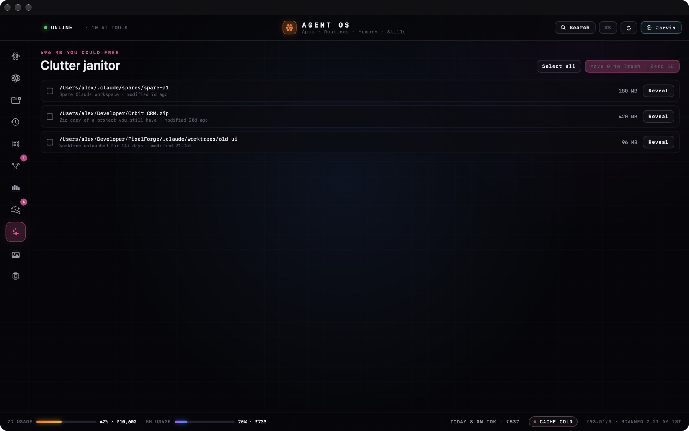 **Clutter janitor** — spare workspaces, stale worktrees, duplicate zips. Moves to Trash only after you confirm. | 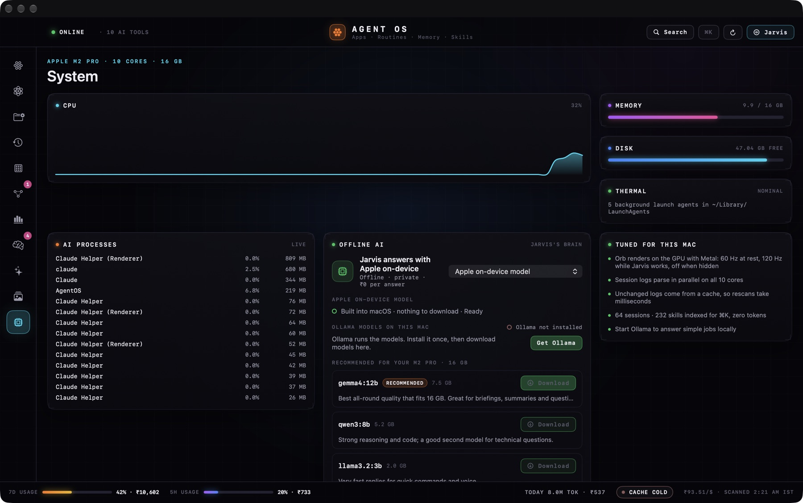 **System** — live CPU, memory, disk, AI processes, plus offline model management. |

**Also:** ⌘K search across everything with zero tokens · live activity log of what your AIs are doing · health score · MCP connector health across apps · menu bar companion with today's spend · open at login · ⌥⌘J to talk to Jarvis from any app · Indian Rupee and IST support out of the box.

---

## Nine ways to see your brain

Switch with the style menu above the orb or **⌘Y**. Every style shows the same real nodes, and every point stays clickable.

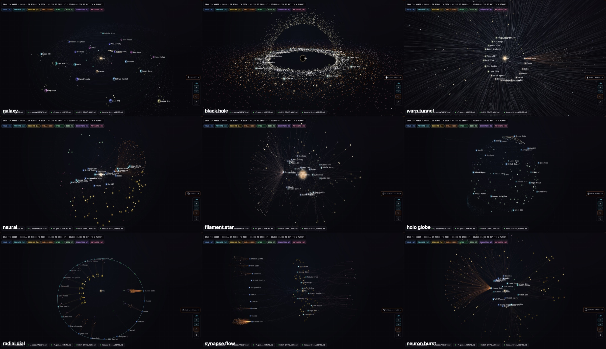

**Galaxy · Black Hole · Warp Tunnel · Neural · Filament Star · Holo Globe · Radial Dial · Synapse Flow · Neuron Burst** — all rendered on the GPU with Metal at up to 120 Hz, idling at 60 Hz and pausing when hidden.

---

## How it works

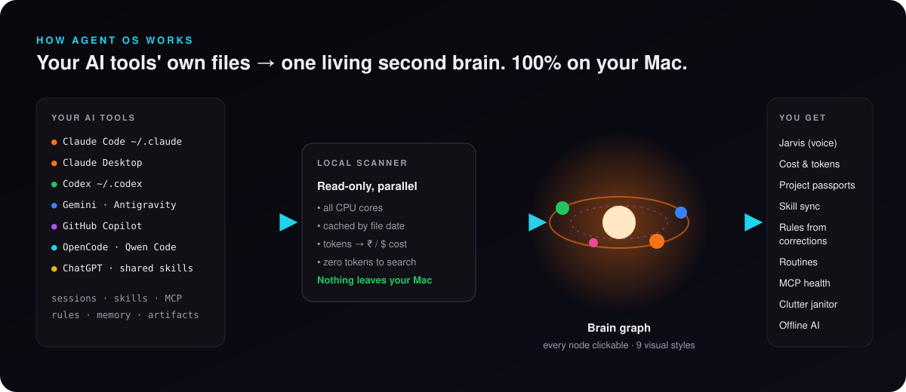

1. **Scan** — a parallel, read-only scanner reads each tool's own files: Claude Code session logs (`~/.claude/projects/*.jsonl`), Codex rollouts, skills folders, MCP configs (`~/.claude.json`, `~/.codex/config.toml`, `~/.gemini/settings.json`, …), rules files and [Basic Memory](https://github.com/basicmachines-co/basic-memory) notes. Unchanged files come from a cache, so rescans are near-instant.
2. **Join** — sessions are grouped into projects (copies like `MyApp` and `MyApp-Windows` merge), tokens are priced per model, skill runs are attributed to the skill that used them.
3. **Show** — a SwiftUI + Metal app turns it into the brain, the dashboards and Jarvis.

### Supported tools

| Tool | Sessions & cost | Skills | MCP connectors | Rules file |
|---|:---:|:---:|:---:|:---:|
| Claude Code | ✅ | ✅ (+ plugins) | ✅ | `~/.claude/CLAUDE.md` |
| Claude Desktop | — | — | ✅ | — |
| Codex | ✅ tokens | ✅ | ✅ | `~/.codex/AGENTS.md` |
| Gemini CLI / Antigravity | — | ✅ | ✅ | `~/.gemini/GEMINI.md` |
| GitHub Copilot | — | ✅ | ✅ | `copilot-instructions.md` |
| OpenCode | — | ✅ | ✅ | `AGENTS.md` |
| Qwen Code | — | ✅ | ✅ | `QWEN.md` |
| ChatGPT | detected | — | — | — |

Adding a tool is one `ToolSpec` in [`ToolCatalog.swift`](Sources/AgentOSKit/ToolCatalog.swift) — PRs welcome!

---

## Jarvis

Press **⌥⌘J** anywhere, or click the mic.

- **Instant, free answers** from local data: *"how much did I spend this week?"*, *"open Orbit CRM"*, *"any broken connectors?"*, *"brief me"*.
- **Offline AI** for everything else: Apple's on-device model (built into macOS, nothing to download) or any [Ollama](https://ollama.com) model, downloadable from inside the app.
- **Claude** as an optional cloud engine through your own Claude Code login.
- Speaks replies with the voice you choose.

---

## Install

1. Download **Agent-OS-macOS-arm64.zip** from the [latest release](../../releases/latest) and unzip it.
2. Drag **Agent OS.app** into **Applications**.
3. The build is not notarized yet, so the first time, **right-click → Open** (or run `xattr -dr com.apple.quarantine "/Applications/Agent OS.app"`).

Requires macOS 26 or later on Apple Silicon. Apple's on-device model needs Apple Intelligence turned on.

> **Try it without your data:** run with fictional demo data —
> `APP_DEMO=1 "/Applications/Agent OS.app/Contents/MacOS/AgentOS"`

## Build from source

```bash
git clone https://github.com/akbehera5000/agent-os.git
cd agent-os
./build.sh --open       # builds, signs ad hoc, installs to /Applications and opens
```

Tests: `swift test --scratch-path ~/Library/Developer/AgentOS/test-build` · In-app self-test: `tools/selftest.sh` · Screenshots: `APP_DEMO=1 tools/snap.sh`

---

## Privacy

- Agent OS **only reads** your AI tools' files. It writes its own cache and routine log to `~/Library/Application Support/AgentOS`.
- It changes other files **only when you press a button** — saving a file you edited, adding a rule, installing or retiring a skill, writing a memory note, moving clutter to the Trash — always with a confirmation.
- Network: a daily public USD→INR exchange rate, model downloads you start, and Claude calls only if you choose the Claude engine. **No telemetry. No account.**
- Costs are **API-equivalent** estimates from published per-token prices; subscription plans bill differently.

---

## Roadmap

- [ ] Notarized builds and auto-update
- [ ] Session parsers for Gemini CLI, OpenCode and Copilot
- [ ] Widgets and Shortcuts actions
- [ ] Currency picker (USD / EUR / INR …)
- [ ] Share a brain snapshot as an image

---

<div align="center">

**If Agent OS helps you tame your AI tools, please ⭐ star the repo — it helps other people find it.**

Built with SwiftUI and Metal · [MIT License](LICENSE) · [Contributing](CONTRIBUTING.md)

</div>
